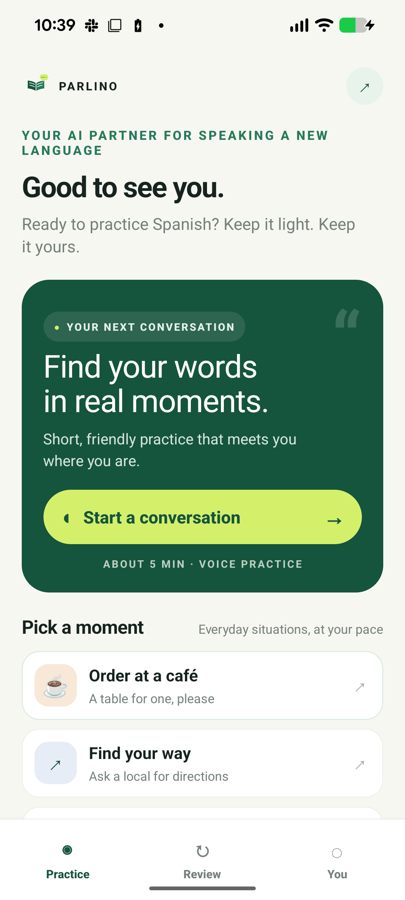
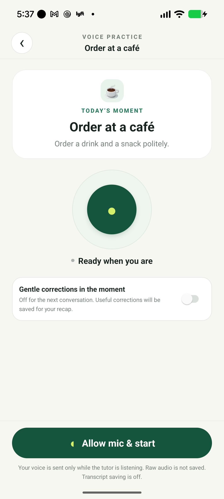

# Parlino

**Your AI partner for speaking a new language.**

Parlino helps language learners build confidence through short, level-aware speaking practice: choose a real-life scenario, talk with an AI tutor, then keep a few useful phrases for review.

The selected Android launcher mark is concept 3 in `images/concepts/`; concepts 1 and 2 are preserved there as alternatives. The app icon uses the concept 3 full-color mark plus adaptive and monochrome layers.

https://console.firebase.google.com/project/parlino-1/overview

## #BuildHybridAI 2026

Parlino is being built for the **Android** track of [#BuildHybridAI 2026](https://firebasehybridaihackathon.devpost.com/). The product focuses on a practical language-learning problem: learners often know vocabulary but have few low-pressure chances to say it out loud.

### Hybrid AI coaching

The Live voice session and generated recap use Firebase AI Logic cloud models. Parlino also offers an optional **Coach this sentence** action after a learner turn. Using Firebase AI Logic Hybrid Inference with `PREFER_ON_DEVICE` and the Gemini Nano 4 Fast preview model, it runs on-device when a local model is available and falls back to cloud inference when it isn’t. The app shows the actual inference source and notifies learners when cloud inference is used; sentence coaching is separate from Live voice and cannot interrupt or change the session. The Android minimum is API 26 (Android 8.0).

Android Hybrid Inference is integrated through a small local Kotlin Expo module that connects Firebase's native Android SDK to the React Native app.

## Product flow

1. **Set up a learner profile:** choose target/native languages, proficiency and goal; no full account is required up front.
2. **Choose a scenario:** café, directions, small talk or workplace—or create a custom situation and practice goal.
3. **Practice by voice:** the learner speaks to a concise, encouraging tutor. Corrections are deferred by default.
4. **Get an optional sentence tip:** after a completed learner turn, tap **Coach this sentence** for a focused correction and brief explanation. The coach prefers Firebase AI Logic on-device inference, reports whether the response came from the device or cloud, and warns when cloud inference is used. It is separate from Live voice and cannot interrupt or discard the session.
5. **Reflect:** get a generated recap with supported corrections, useful phrases and a positive note.
6. **Review:** save phrases and revisit them on a simple 1, 3, 7, 14 and 30-day reminder cadence. This is a practical reminder schedule, not a scientific claim.

## How Parlino uses Firebase

Firebase is the app's AI and progress backend—not just a listed dependency:

- **Firebase AI Logic — Live voice tutor** (`src/services/aiSession.ts`): calls React Native Firebase's `getLiveGenerativeModel`, opens a Live session, sends 16 kHz PCM microphone chunks with `sendAudioRealtime`, and plays streamed audio responses. Microphone chunks are sent only while the tutor is listening, with an echo guard while tutor audio plays. `patches/@react-native-firebase+ai+27.1.1.patch` adds the App Check header to React Native's Live WebSocket handshake; `npm ci` applies this patch through `postinstall`. The tutor prompt is assembled in `src/services/tutorPrompt.ts`. The configured Live model is `gemini-3.1-flash-live-preview`.
- **Firebase AI Logic — recap** (`src/services/recapService.ts`): calls `getGenerativeModel` with `gemini-3.8-flash` to turn the session transcript into a structured recap, and falls back to `gemini-3.5-flash-lite` when the primary model reports transient capacity/server errors. The result is validated by `src/domain/recap.ts` before it is displayed or saved.
- **Firebase AI Logic — sentence coach** (`src/services/sentenceCoach.ts`, `modules/parlino-hybrid-ai/`): an optional Kotlin Expo module calls Android Hybrid Inference with `PREFER_ON_DEVICE` and the Gemini Nano 4 Fast preview option. It reports the actual inference source, discloses cloud use, and tries the cloud model once if the hybrid request fails.
- **Firebase Authentication** (`src/services/auth.ts`): anonymous sign-in gives each guest a Firebase UID without requiring account creation before practice.
- **Cloud Firestore** (`src/services/progress.ts`): stores learner settings, session records/recaps and saved phrases under `users/{uid}`. A session record and aggregate learner/tutor turn counts are saved as soon as practice ends, so Progress updates even if recap generation is temporarily unavailable. Transcript saving is opt-in and off by default. `firestore.rules` enforces per-user ownership.
- **Firebase App Check** (`src/services/firebase.ts`): debug provider for development and private sideloaded builds; Play Integrity is reserved for production distribution through Google Play. AI Logic App Check enforcement stays enabled. Register each test device's debug token in the same Firebase project's Android app entry; never ship or publish a debug token.
- **Local persistence:** AsyncStorage holds settings/progress for use before Firebase is configured and syncs guest data when Firebase becomes available.

No provider API key or service-account credential is bundled in the app. The Firebase Android config file is client configuration, is git-ignored, and is not a substitute for server credentials.

## Repository hygiene

- `google-services.json`, `.env*`, Firebase CLI logs/cache, service-account key files, `PROMPT.md`, generated Android sources/build products and `dist/` are excluded from Git.
- `.easignore` intentionally allows the local `google-services.json` into protected EAS build uploads; it remains excluded from the public source repository.
- The debug APK is a local build artifact and is not committed. Never commit an App Check debug token or Android signing keystore.
- The tracked `patches/` file is an intentional `patch-package` patch for React Native Firebase AI 27.1.1. `npm ci` applies it automatically; do not remove it unless the dependency is upgraded and the Live WebSocket App Check header behavior is verified.

## Build and run Android locally (sideloaded; no Play Store)

Parlino can be built and installed locally without publishing it to Google Play. Expo Go is not supported because React Native Firebase and the audio modules need a native Android build.

### Prerequisites

- A Node.js version supported by Expo SDK 58 (Node 22.13.x, 24.3+, 26.x, or 27+).
- JDK **17**, Android SDK and Android platform tools (`adb`).
- A Firebase project and local `google-services.json`; see [Firebase project setup](#firebase-project-setup) below.
- For voice testing, an Android device with microphone access, internet, and USB debugging enabled.

The Expo config sets Kotlin Gradle plugin 2.4.0 via `expo-build-properties`, matching the Kotlin metadata used by the resolved Firebase Auth Android dependency. `npm ci` also runs `patch-package`, which applies the tracked Live API App Check patch.

### Development build (Metro)

```sh
npm ci
npx expo install --check
npx expo run:android
```

For a connected physical device, use `npx expo run:android --device`. Start Metro with:

```sh
npm start
```

The EAS development profile is configured in `eas.json`:

```sh
npx eas-cli build --platform android --profile development
```

### Standalone test APK (sideloaded, no Metro)

Use the App Check **debug provider** for a local or sideloaded judging build; a Play Integrity registration alone is not sufficient for an APK installed outside Google Play. The `standalone-test` profile embeds the JavaScript bundle, so the installed APK does not need Metro or the build computer running. Keep this debug build private. Firebase AI calls still require internet access.

After completing Firebase project setup and placing `google-services.json` in the repository root, build locally from macOS/Linux:

```sh
# Point these at your local JDK 17 and Android SDK installations.
# Common Android SDK paths: macOS $HOME/Library/Android/sdk; Linux $HOME/Android/Sdk.
export JAVA_HOME="/path/to/jdk-17"
export ANDROID_HOME="/path/to/android-sdk"
export PATH="$JAVA_HOME/bin:$ANDROID_HOME/platform-tools:$PATH"

PARLINO_APP_CHECK_PROVIDER=debug npx expo prebuild --platform android --no-install
PARLINO_APP_CHECK_PROVIDER=debug EXPO_PUBLIC_APP_CHECK_DEBUG=true \
  ./android/gradlew -p android assembleRelease

adb install -r android/app/build/outputs/apk/release/app-release.apk
adb shell monkey -p com.parlino.app 1
```

The APK is written to `android/app/build/outputs/apk/release/app-release.apk`. To build with EAS instead, run `npx eas-cli build --platform android --profile standalone-test`; the profile sets the debug-provider flags.

Each device needs an App Check debug token registered for the exact Android app in the Firebase project used by that build. To view a token on a test device, start a log stream, then force-stop and reopen Parlino:

```sh
adb logcat | grep -F "Firebase App Check debug token"
# In another terminal:
adb shell am force-stop com.parlino.app
adb shell monkey -p com.parlino.app 1
```

Register the displayed token in **Firebase Console → App Check → Apps → Parlino (`com.parlino.app`) → Manage debug tokens**. A judge using their own Firebase project must use that project's `google-services.json` and register their own device token there. If using a shared project, the project owner must add each judge's token privately. **Do not put debug tokens in source control, Devpost, or public issue comments.**

Native dependency or configuration changes require rebuilding. `npx expo prebuild --clean` regenerates the Android native project and overwrites generated native files; inspect any native edits before running it.

## Firebase project setup

1. Create a Firebase project and register an Android app with package name **`com.parlino.app`** (configured in `app.config.ts`).
2. Download its `google-services.json` to the project root. Expo attaches the Firebase config plugins when this file exists and processes the Google Services Gradle plugin during prebuild. The file is git-ignored; `.easignore` includes it in protected EAS uploads without adding it to Git.
3. Enable **Anonymous** under Authentication providers.
4. Create a Cloud Firestore database and publish the rules from `firestore.rules`.
5. In Firebase Console, enable Firebase AI Logic and complete its Gemini provider setup. Keep **Basic App Check enforcement enabled** for AI Logic; Replay protection can remain off for this test setup.
6. Build the local/sideloaded APK with the debug provider as described above, then register each test device's debug token under **App Check → Apps → Manage debug tokens**. Keep tokens private. Play Integrity is for production builds distributed through Google Play, not this sideloaded test APK.
7. Rebuild the native app after adding or changing Firebase configuration:

   ```sh
   npx expo prebuild
   npx expo run:android
   ```

There is no Firebase AI Logic emulator; real model calls require a configured Firebase project and network access. Voice should be tested on a physical Android device as well as an emulator.

## Privacy and data

- Raw microphone audio is streamed to Firebase AI Logic during a voice session; this app does not save raw audio.
- The optional sentence coach runs only when tapped; its prompt includes the selected learner sentence and the learner's target language, native language, and proficiency. It prefers on-device inference; when the device/model cannot run it, the UI warns that Firebase AI Logic cloud inference will be used. Coach output is not persisted.
- Transcripts are not persisted by default. If **Save session transcripts** is enabled, the transcript is saved with the session. Recaps, session metadata and saved phrases are otherwise the progress data stored in Firestore.
- Before recap generation, the active transcript is held in memory. If recap generation fails, Parlino does not fabricate recap content.
- Firestore data is scoped to the authenticated UID. Review `firestore.rules` before changing the schema.

## What's next for Parlino

1. Expand the scenario library and language-practice options.
2. Add reusable saved custom scenarios.
3. Continue refining the learner experience based on feedback.
<!--
## Hackathon submission checklist

- [ ] Configure the Firebase project, App Check and a working Android judging build.
- [ ] Add an open-source `LICENSE` file; the contest requires one for the public repository.
- [ ] Publish the source repository and include it in the Devpost entry.
- [ ] In the Devpost description, explain Parlino's value proposition, project features and specifically how Firebase AI Logic is used.

See the [official challenge page](https://firebasehybridaihackathon.devpost.com/) for the full rules, deliverables and judging criteria.
 -->

## Verification

Pure logic tests, type checking and linting:

```sh
npm test
npm run typecheck
npm run lint
npx expo-doctor
```

The standalone Android APK builds locally, embeds the JavaScript bundle, and can be sideloaded without Play Store or Metro. The current test build uses the debug provider, sends App Check on the Live WebSocket handshake, and only forwards microphone audio while the tutor is listening. Keep the APK private and register the device's debug token in the Firebase project configured in that build. The code passes the local test, typecheck, and lint suites.

## References

- [#BuildHybridAI 2026 challenge](https://firebasehybridaihackathon.devpost.com/)
- [Firebase AI Logic hybrid inference](https://firebase.google.com/docs/ai-logic/hybrid)
- [Firebase AI Logic Live API](https://firebase.google.com/docs/ai-logic/live-api)
- [React Native Firebase AI Logic](https://rnfirebase.io/ai/usage)
- [React Native Firebase App Check](https://rnfirebase.io/app-check/usage)
- [Firebase Android App Check debug provider](https://firebase.google.com/docs/app-check/android/debug-provider)
- [Expo Audio](https://docs.expo.dev/versions/latest/sdk/audio/)
- [Expo development builds](https://docs.expo.dev/develop/development-builds/introduction/)
- [Expo SDK reference and supported Node versions](https://docs.expo.dev/versions/latest/)

## Pixel 8 screenshots

Captured from the installed Android standalone test build. The voice-practice screen is shown before a session starts; the corrections setting applies to the next conversation and is hidden once a session is in flight.

<p align="center">
  
  
</p>

<p align="center">
  
  
</p>
