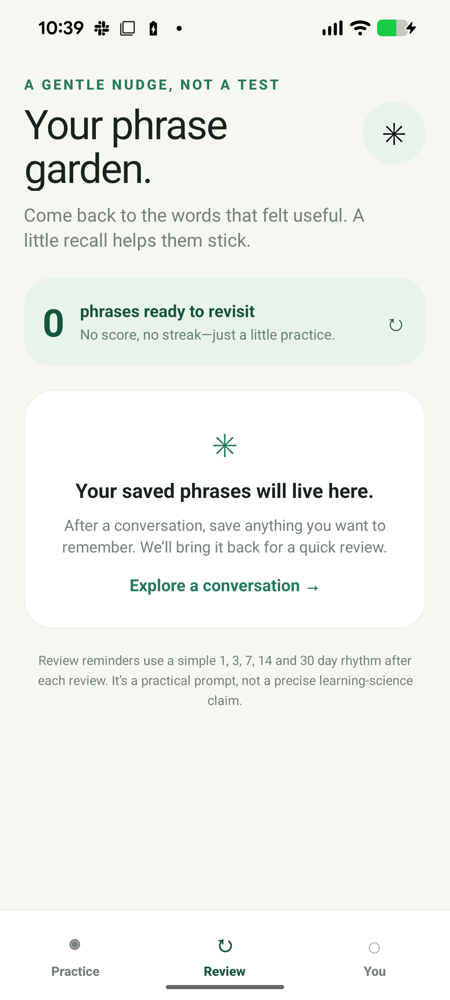
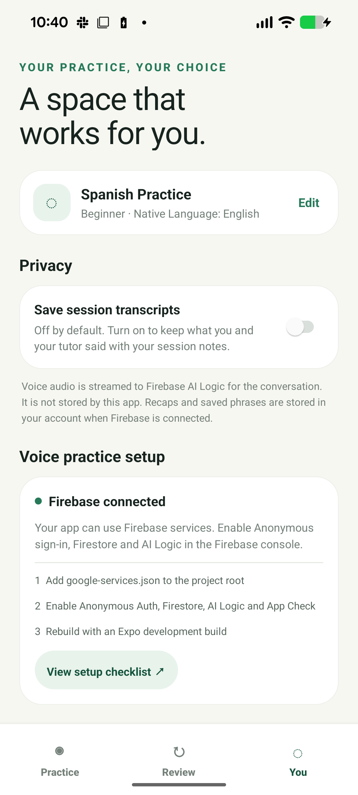
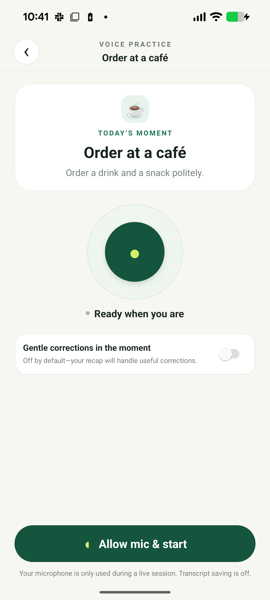

# Parlino

**Your AI partner for speaking a new language.**

Parlino helps language learners build confidence through short, level-aware speaking practice: choose a real-life scenario, talk with an AI tutor, then keep a few useful phrases for review.

The selected Android launcher mark is concept 3 in `images/`; concepts 1 and 2 are preserved as alternatives. The app icon uses the concept 3 full-color mark plus adaptive and monochrome layers.

https://console.firebase.google.com/project/parlino-1/overview

## #BuildHybridAI 2026

Parlino is being built for the **Android** track of [#BuildHybridAI 2026](https://firebasehybridaihackathon.devpost.com/). The product focuses on a practical language-learning problem: learners often know vocabulary but have few low-pressure chances to say it out loud.

### Important: current hybrid-inference status

The current MVP calls **Firebase AI Logic cloud models** for its Live voice session and generated recap. It does **not yet** implement the hackathon's central **Firebase AI Logic Hybrid Inference** requirement: on-device Gemini Nano 4 inference with an appropriate cloud fallback. Local AsyncStorage persistence is only local data storage; it is not on-device AI inference. Do not describe the current build as a hybrid-inference implementation until that flow is implemented and demonstrated.

A promising next step is to add a hybrid text-practice feature—such as generating a short scenario warm-up or phrase drill on-device when Gemini Nano 4 is available, with Firebase AI Logic cloud fallback otherwise. The existing streamed voice conversation can remain a separate Firebase AI Logic Live experience.

## Product flow

1. **Set up a learner profile:** choose target/native languages, proficiency and goal; no full account is required up front.
2. **Choose a scenario:** café, directions, small talk or workplace.
3. **Practice by voice:** the learner speaks to a concise, encouraging tutor. Corrections are deferred by default.
4. **Reflect:** get a generated recap with supported corrections, useful phrases and a positive note.
5. **Review:** save phrases and revisit them on a simple 1, 3, 7, 14 and 30-day reminder cadence. This is a practical reminder schedule, not a scientific claim.

## How Parlino uses Firebase

Firebase is the app's AI and progress backend—not just a listed dependency:

- **Firebase AI Logic — Live voice tutor** (`src/services/aiSession.ts`): calls React Native Firebase's `getLiveGenerativeModel`, opens a Live session, sends 16 kHz PCM microphone chunks with `sendAudioRealtime`, and plays streamed audio responses. The tutor prompt is assembled in `src/services/tutorPrompt.ts`. The currently configured Live model is `gemini-2.5-flash-native-audio-preview-12-2025`; verify its availability before a judging/demo build because Live is a Preview product and model availability can change.
- **Firebase AI Logic — recap** (`src/services/recapService.ts`): calls `getGenerativeModel` with `gemini-3.8-flash` to turn the session transcript into a structured recap. The result is validated by `src/domain/recap.ts` before it is displayed or saved.
- **Firebase Authentication** (`src/services/auth.ts`): anonymous sign-in gives each guest a Firebase UID without requiring account creation before practice.
- **Cloud Firestore** (`src/services/progress.ts`): stores learner settings, session summaries and saved phrases under `users/{uid}`. Transcript saving is opt-in and off by default. `firestore.rules` enforces per-user ownership.
- **Firebase App Check** (`src/services/firebase.ts`): debug provider in development, Play Integrity in production. AI Logic App Check enforcement is required; register the development token in Firebase Console and never ship a debug token.
- **Local persistence:** AsyncStorage holds settings/progress for use before Firebase is configured and syncs guest data when Firebase becomes available. This is not a local model or an offline AI fallback.

No provider API key or service-account credential is bundled in the app. The Firebase Android config file is client configuration, is git-ignored, and is not a substitute for server credentials.

## Repository hygiene

- `google-services.json`, `.env*`, Firebase CLI logs/cache, service-account key files, `PROMPT.md`, generated Android sources/build products and `dist/` are excluded from Git.
- `.easignore` intentionally allows the local `google-services.json` into protected EAS build uploads; it remains excluded from the public source repository.
- The debug APK is a local build artifact and is not committed. Never commit an App Check debug token or Android signing keystore.

## Run the Android development build

Expo Go is not supported: React Native Firebase and the audio modules need a native development build.

The Expo config sets Kotlin Gradle plugin 2.4.0 via `expo-build-properties`, matching the Kotlin metadata used by the resolved Firebase Auth Android dependency.

```sh
npm install
npx expo install --check
npx expo prebuild
npx expo run:android
```

For a connected physical device, use `npx expo run:android --device`. After installing the development client, start Metro with:

```sh
npm start
```

The EAS development profile is configured in `eas.json`:

```sh
npx eas-cli build --platform android --profile development
```

### Standalone Android test APK (no Metro)

The `standalone-test` profile embeds the JavaScript bundle, so the installed APK does not need Metro or this computer running. It explicitly uses the App Check **debug provider** for private device testing; register that device's generated token in Firebase Console before calling AI Logic. Never distribute this build publicly. Firebase calls still require internet access.

For a local build, set the public build-time flag while Metro bundles the release JavaScript:

```sh
JAVA_HOME=/path/to/jdk-17 ANDROID_HOME="$HOME/Library/Android/sdk" EXPO_PUBLIC_APP_CHECK_DEBUG=true ./android/gradlew -p android assembleRelease
```

The APK is written to `android/app/build/outputs/apk/release/app-release.apk`. Alternatively, run `npx eas-cli build --platform android --profile standalone-test`.

Native dependency or configuration changes require rebuilding. `npx expo prebuild --clean` regenerates the Android native project and overwrites generated native files; inspect any native edits before running it.

## Firebase project setup

1. Create a Firebase project and register an Android app with package name **`com.parlino.app`** (configured in `app.config.ts`).
2. Download its `google-services.json` to the project root. Expo attaches the Firebase config plugins when this file exists and processes the Google Services Gradle plugin during prebuild. The file is git-ignored; `.easignore` includes it in protected EAS uploads without adding it to Git.
3. Enable **Anonymous** under Authentication providers.
4. Create a Cloud Firestore database and publish the rules from `firestore.rules`.
5. In Firebase Console, enable Firebase AI Logic and complete its Gemini provider setup. Confirm App Check enforcement is enabled for AI Logic.
6. For development, run the app, get the App Check debug token from Android logs, and register it in Firebase Console under **App Check → Apps → Manage debug tokens**. Keep it private. For production, register Android with Play Integrity.
7. Rebuild the native app after setup:

   ```sh
   npx expo prebuild
   npx expo run:android
   ```

There is no Firebase AI Logic emulator; real model calls require a configured Firebase project and network access. Voice should be tested on a physical Android device as well as an emulator.

## Privacy and data

- Raw microphone audio is streamed to Firebase AI Logic during a voice session; this app does not save raw audio.
- Transcripts are not persisted by default. If **Save session transcripts** is enabled, the transcript is saved with the session. Recaps, session metadata and saved phrases are otherwise the progress data stored in Firestore.
- Before recap generation, the active transcript is held in memory. If recap generation fails, Parlino does not fabricate recap content.
- Firestore data is scoped to the authenticated UID. Review `firestore.rules` before changing the schema.

## Hackathon submission checklist

- [ ] Implement and demonstrate Firebase AI Logic Hybrid Inference on Android: Gemini Nano 4 on-device plus cloud fallback.
- [ ] Configure the Firebase project, App Check and a working Android judging build.
- [ ] Add an open-source `LICENSE` file; the contest requires one for the public repository.
- [ ] Publish the source repository and include it in the Devpost entry.
- [ ] Record a public YouTube demo (no longer than 3 minutes; English or English subtitles) showing the app working on Android.
- [ ] In the Devpost description, explain Parlino's value proposition, project features and specifically how Firebase AI Logic is used.

See the [official challenge page](https://firebasehybridaihackathon.devpost.com/) for the full rules, deliverables and judging criteria.

## Verification and current limitations

Pure logic tests, type checking and linting:

```sh
npm test
npm run typecheck
npm run lint
npx expo-doctor
```

The standalone Android test APK built successfully, was installed on a Pixel 8, and launched without a native crash. It is `android/app/build/outputs/apk/release/app-release.apk` (all Android ABIs; about 103 MB), embeds the JavaScript bundle, and does not need Metro. It uses the App Check debug provider and is for private testing only; it is excluded from Git. A successful Firebase AI conversation still requires AI Logic to be enabled in the correct project and this device's debug token to be allow-listed.

Other known limitations: Firebase AI Logic Live is Preview; the Live model must be rechecked before demos; anonymous accounts are not linked to a durable sign-in method; and the hybrid on-device/cloud inference feature required by the challenge is not implemented yet.

## References

- [#BuildHybridAI 2026 challenge](https://firebasehybridaihackathon.devpost.com/)
- [Firebase AI Logic hybrid inference](https://firebase.google.com/docs/ai-logic/hybrid)
- [Firebase AI Logic Live API](https://firebase.google.com/docs/ai-logic/live-api)
- [React Native Firebase AI Logic](https://rnfirebase.io/ai/usage)
- [React Native Firebase App Check](https://rnfirebase.io/app-check/usage)
- [Expo Audio](https://docs.expo.dev/versions/latest/sdk/audio/)
- [Expo development builds](https://docs.expo.dev/develop/development-builds/introduction/)

## Pixel 8 screenshots

Captured from the installed Android standalone test build. The voice screen is shown before starting a session.

<p align="center">
  
  
</p>

<p align="center">
  
  
</p>
